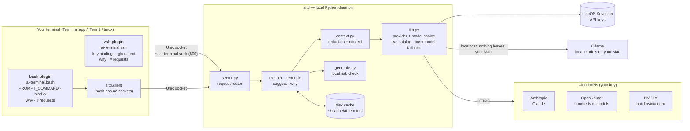
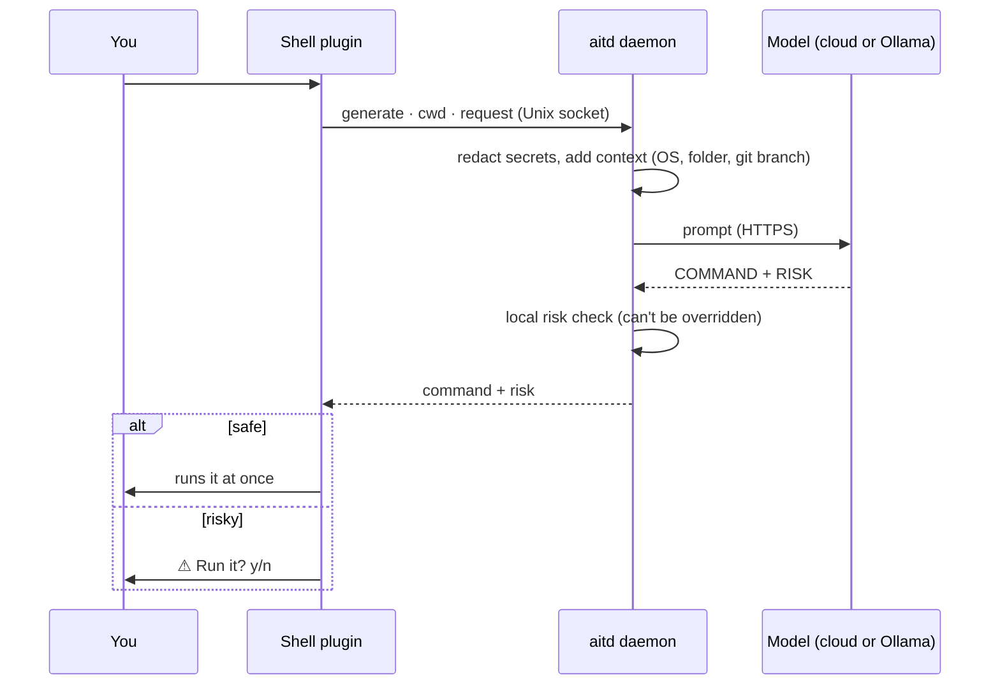

<div align="center">

# Shelldon

**Intelligence in Terminal. SI in the terminal you already have.**

Suggestions as you type, plain-English commands, instant explanations and "why did that fail?",<br>
inside macOS Terminal and iTerm2, in **zsh or bash**. No new app, no subscription.

[](https://github.com/thejunghare/shelldon/actions/workflows/ci.yml)
[](LICENSE)

[](https://github.com/thejunghare/shelldon/stargazers)
[](https://www.buymeacoffee.com/thejunghare)

</div>

```
% # make a new folder for my notes
  SI · 1.4s
% mkdir -p notes

% find . -name '*.log' -mtime +7 -delete        ← press Ctrl+E

  Deletes .log files older than 7 days in this folder and below.

  find .          Search from the current folder
  -name '*.log'   Only files ending in .log
  -mtime +7       Modified more than 7 days ago
  -delete         Delete each match without asking

  ⚠︎ Deleted files skip the Trash and can't be recovered.
  1.8s

% git sta▍tus                                   ← grey suggestion, press → to accept
```

---

## Why I built this

The first time I saw intelligence inside a terminal was in **Warp**, and it felt like the obvious future: ask in plain English, get the command, understand what it does. But the full experience sat behind a paid plan, which was out of my reach. It also meant installing a whole new terminal app, when macOS already ships a terminal that does everything right.

**We already had a terminal. We just needed intelligence in it.**

I also teach Linux and Bash commands to students at **School of Future Tech**. We live in the terminal every class: installing tools, moving around folders, running commands for the first time. Having suggestions, explanations and plain-English help **right inside the terminal they already use** turned out to be a huge plus. Students see what a command does *before* they run it, and nothing risky runs without asking.

So Shelldon is a small, free, open-source plugin for zsh and bash. Bring your own API key (NVIDIA's is free), and your existing terminal gets smarter.

## Features

| | |
|---|---|
| **Ask in plain English** | Type `# make a new folder here` and press Return. Safe commands run straight away; risky ones ask `y/n` first. |
| **Why did that fail?** | Type `why` after an error. You get the cause in one line and the likely fix, ready to run. |
| **Explain any command** | Press `Ctrl+E` before running something. A quiet, native-looking breakdown appears above your prompt. |
| **Suggestions as you type** | Grey ghost text after the cursor: from your history instantly, from the SI after a short pause. Press `→` to accept. (zsh) |
| **zsh and bash** | Works in both, including the bash 3.2 that ships with macOS. |
| **Safety first** | A local risk check flags deletes, overwrites, `sudo`, `git reset --hard`, recursive permission changes, stopping processes and `curl \| sh`, whatever the SI says. |
| **Private by design** | API key in the macOS Keychain, secrets redacted before anything leaves your Mac, shell history never sent. |
| **Fast** | A small background daemon keeps connections warm, answers are cached on disk, and stale requests are cancelled as you type. |
| **Your choice of AI** | Local models with [Ollama](https://ollama.com) (free, offline, nothing leaves your Mac), hundreds of models through one [OpenRouter](https://openrouter.ai) key (many free), a free [NVIDIA](https://build.nvidia.com) key, or [Anthropic](https://console.anthropic.com) (Claude) for the best answers. Switch any time with `ait use`. |

## Quick start

**Requirements:** macOS, zsh or bash, Python 3.10+.

```bash
git clone https://github.com/thejunghare/shelldon.git ~/shelldon
~/shelldon/install.sh
```

**This is a one-time setup.** The installer hooks Shelldon into both zsh (`~/.zshrc`) and bash (`~/.bashrc` and your login profile) and puts the `ait` command in `~/.local/bin`, so every new terminal tab is ready by itself. Open a new tab, then connect an AI, either an API key:

```bash
ait key        # paste an Anthropic, OpenRouter or NVIDIA key; it goes into the macOS Keychain
ait models     # pick the fastest model that answers for you
ait status     # check it worked
```

or local models with Ollama: free, offline, and nothing leaves your Mac:

```bash
brew install ollama && brew services start ollama
ollama pull llama3.2:3b
ait use ollama
```

See [AI providers and models](#ai-providers-and-models) for details.

**Updating:** `ait update` pulls the latest version and restarts the daemon. No need to run `install.sh` again.
**Something not working?** `ait doctor` checks your setup and says how to fix each problem.

## zsh or bash?

Everything works in zsh, the macOS default. bash gets everything except ghost suggestions, because bash's line editor (readline) can't draw grey text after the cursor.

| Feature | zsh | bash 4+ | bash 3.2 (macOS built-in) |
|---|:-:|:-:|:-:|
| `# request` + Return | ✅ | ✅ | ✅ |
| `why` | ✅ fix placed on your prompt | ✅ press `↑` for the fix | ✅ press `↑` for the fix |
| `Ctrl+E` explain | ✅ (async, keep typing) | ✅ | use `ait explain <cmd>` |
| `Ctrl+G` write a command | ✅ | ✅ | use `# request` |
| Suggestions as you type | ✅ | ❌ | ❌ |
| `ait` commands | ✅ | ✅ | ✅ |

Newer bash: `brew install bash`. To switch Terminal.app to zsh instead: *Terminal → Settings → General → Shells open with → Default login shell*.

## Usage

### Ask in plain English

Start a line with `#`, say what you want, press Return:

```
% # show the 5 biggest files in here
  SI · 1.6s
% du -ah . | sort -rh | head -5
```

Risky commands wait for you:

```
% rm -r old-builds
⚠︎ Deletes files. They skip the Trash. Run it? y/n  1.2s
```

`y` runs it; any other key leaves it unrun, for you to edit. In zsh, `Ctrl+C` or `Esc` cancels while it's thinking, and `Ctrl+G` works on a line without the `#`.

### Why did that fail?

After a command fails, type `why`:

```
% git psuh origin main
git: 'psuh' is not a git command. See 'git --help'.
% why
  You typed psuh instead of push.

  git push origin main   Push with the right spelling

  First fix is on your prompt. Return runs it.  1.4s
% git push origin main
```

`why` reads the end of the failed command's output from the screen (Terminal.app, iTerm2 and tmux). The first time, macOS asks whether Terminal may control Terminal; allow it, or set `AIT_WHY_SCREEN=0` and `why` works from the command and exit status alone. You can also pipe output in: `make 2>&1 | why`. A risky fix (deletes, `sudo`, …) is shown but never put on your prompt.

### Suggestions (zsh)

Just type. A matching command from your history appears in grey immediately; otherwise the SI suggests one after a short pause. `→`, `End` or `Ctrl+F` accepts it, and typing anything else ignores it.

### Explain

Type a command, **don't press Enter**, press `Ctrl+E`. If the cursor is mid-line, the first press jumps to the end (as `Ctrl+E` normally does) and the second explains.

### The `ait` command

| Command | What it does |
|---|---|
| `ait key` | Save an API key to the Keychain (Anthropic, OpenRouter or NVIDIA) |
| `ait use <provider>` | Switch between `anthropic`, `openrouter`, `nvidia`, `ollama`, or `auto` |
| `ait status` | Show the daemon, provider and model |
| `ait models` | Find the fastest model that answers on the current provider, and use it from now on |
| `ait suggest on` / `history` / `off` | SI + history suggestions, history only, or none (zsh) |
| `ait explain <cmd>` | Explain without the key binding |
| `ait why` | Same as `why`, if another `why` command already exists |
| `ait start` / `stop` / `restart` | Manage the background daemon (it starts automatically) |
| `ait log` | Show the daemon log |
| `ait doctor` | Check the setup: Python, shell, startup files, PATH, API key, daemon |
| `ait update` | Update to the latest version and restart |

## AI providers and models

Shelldon works with four providers. Pick one, or set up several and switch with `ait use`.

| Provider | What you need | Cost | Good for |
|---|---|---|---|
| **Ollama** (local) | [Ollama](https://ollama.com) installed and one model pulled | Free | Privacy, offline use, classrooms: nothing leaves your Mac, never "busy" |
| **OpenRouter** | A key from [openrouter.ai/keys](https://openrouter.ai/keys) (`sk-or-…`) | Many free models; others pay per use | One key for hundreds of models |
| **NVIDIA** | A key from [build.nvidia.com](https://build.nvidia.com) → any model → *Get API Key* (`nvapi-…`) | Free tier | Free cloud models (busy at peak times) |
| **Anthropic** | A key from [console.anthropic.com](https://console.anthropic.com) → *API Keys* (`sk-ant-…`) | Pay per use | The most reliable, highest-quality answers |

**Saving a key.** Run `ait key` and paste it. The provider is detected from the prefix, and the key is stored in the macOS Keychain (services `ai-terminal`, `ai-terminal-openrouter`, `ai-terminal-nvidia`), never in a file. You can also set `ANTHROPIC_API_KEY`, `OPENROUTER_API_KEY` or `NVIDIA_API_KEY` in your environment; those take priority over the Keychain. Ollama needs no key.

**Which provider is used.** `ait use <provider>` remembers your choice (`AIT_PROVIDER` overrides it). With `ait use auto` (the default), it's the first available of: Anthropic key, OpenRouter key, NVIDIA key, a running Ollama.

**Picking a model.** Run `ait models` on any provider. Shelldon asks the provider which models you can use, tries the likeliest (small, fast and, on OpenRouter, free ones first), keeps the fastest that answers and remembers the others as backups. If a model is busy, rate limited or missing, the next one takes over automatically.

| | Anthropic | OpenRouter | NVIDIA | Ollama |
|---|---|---|---|---|
| Default model | `claude-sonnet-5-5` (explain, `why`, `#`), `claude-haiku-5-5` (suggestions) | Fastest free model from `ait models` | `openai/gpt-oss-20b`, else fastest from `ait models` | Smallest installed model, or fastest from `ait models` |
| Choose your own | `AIT_EXPLAIN_MODEL`, `AIT_SUGGEST_MODEL` | `AIT_OPENROUTER_MODEL`, `AIT_OPENROUTER_SUGGEST_MODEL` | `AIT_NVIDIA_EXPLAIN_MODEL`, `AIT_NVIDIA_SUGGEST_MODEL` | `AIT_OLLAMA_MODEL`, `AIT_OLLAMA_SUGGEST_MODEL` |

**Ollama tips.** Good starting models: `llama3.2:3b` (fast, runs on any Apple Silicon Mac) and `qwen2.5-coder:7b` (better with commands, needs about 8 GB of RAM). The first request after Ollama starts loads the model into memory and can take a few seconds. Running Ollama on another machine? Set `AIT_OLLAMA_URL=http://that-machine:11434`.

**OpenRouter tips.** Free models (ids ending in `:free`) have daily limits; Shelldon moves to another free model when one is used up. To use a paid model, add credits on OpenRouter and set `AIT_OPENROUTER_MODEL`.

After changing a key or model variable, run `ait restart`.

## Configuration

Add any of these above the `source` line in `~/.zshrc` or `~/.bashrc`:

| Variable | Default | Meaning |
|---|---|---|
| `AIT_CONFIRM` | `risky` | `all` asks before running every SI-written command |
| `AIT_WHY_SCREEN` | `1` | `0` stops `why` reading the terminal screen |
| `AIT_SUGGEST` | `1` | `0` turns ghost suggestions off (zsh) |
| `AIT_AI_SUGGEST` | `1` | `0` keeps suggestions to your history only (zsh) |
| `AIT_SUGGEST_DELAY` | `0.8` | Seconds of pause before asking the SI (zsh) |
| `AIT_SUGGEST_STYLE` | `fg=8` | How ghost text is drawn, e.g. `fg=240` for fainter (zsh) |
| `AIT_EXPLAIN_KEY` | `^E` (zsh), `\C-e` (bash) | Key binding for explain |
| `AIT_PROVIDER` | unset | Force `anthropic`, `openrouter`, `nvidia` or `ollama` (overrides `ait use`) |
| `AIT_TIMEOUT` | `60` | Seconds to wait for an answer |
| `NO_COLOR` | unset | `1` for output without colour |

Model variables are in [AI providers and models](#ai-providers-and-models).

## Privacy & safety

- **What's sent:** only the line you're working on, plus a short context (macOS version, current folder, git branch). When you type `why`, also the failed command, its exit status and the last 60 lines of its output.
- **Redacted first:** API keys, tokens, private keys, `PASSWORD=…`/`SECRET=…`-style variables and `user:pass@` URLs become `[REDACTED]`; lines containing them never get suggestions.
- **Never sent:** your shell history (used locally for suggestions only) and your files.
- **Fully local option:** with Ollama, nothing leaves your Mac at all.
- **Never auto-run when risky:** the local risk check can't be skipped by the SI.
- **Keys:** stored in the macOS Keychain. Cached answers live in `~/.cache/ai-terminal/`.

See [SECURITY.md](SECURITY.md) for details and how to report a vulnerability.

## Architecture



**What happens when you type `# make a folder` and press Return:**



The plugin never blocks your typing: requests go to a small local daemon over a private Unix socket, and answers come back asynchronously. The daemon keeps API connections warm, caches answers, and cancels suggestion requests you've typed past.

## Roadmap

- [x] Explain commands (`Ctrl+E`)
- [x] Plain-English → command with a risk check
- [x] Suggestions as you type
- [x] `why`: explain the last failed command
- [x] bash support
- [ ] Homebrew install (`brew install shelldon`)
- [x] Local models via Ollama, fully offline
- [x] OpenRouter: hundreds of models with one key

Ideas and votes welcome in [Issues](https://github.com/thejunghare/shelldon/issues).

## Contributing

Pull requests are welcome. See [CONTRIBUTING.md](CONTRIBUTING.md) for the layout, tests and guidelines. If Shelldon helps you or your students, a ⭐ helps other people find it.

## Support the project

Shelldon is free and always will be. If it saves you time, you can buy me a coffee ☕. It keeps the late-night commits going.

<a href="https://www.buymeacoffee.com/thejunghare"></a>

## License

[MIT](LICENSE) © Prasad Junghare
